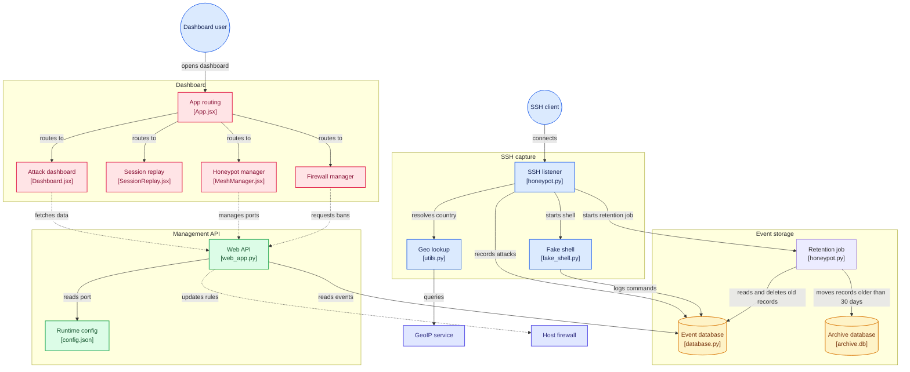
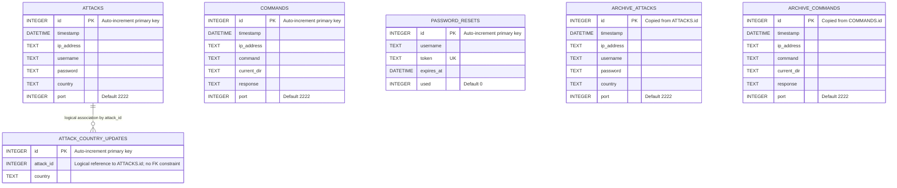

# Honeypot Swarm

Honeypot Swarm is a self-hosted SSH deception and monitoring application. It runs
Paramiko-based SSH honeypots, records authentication attempts and commands
entered into a simulated shell, and provides a React dashboard for reviewing
activity and managing honeypot instances.

> **Security notice:** This software is intended for controlled security
> monitoring and research. A honeypot is an intentionally exposed service.
> Deploy it only on systems and networks you own or are authorized to monitor,
> isolate it from sensitive systems, and restrict access to its dashboard and
> stored data.

## Features

- Capture SSH connection attempts, including source IP, username, password,
  timestamp, listening port, and (when available) country.
- Accept SSH password authentication and provide an interactive **simulated**
  shell. Shell commands and responses are recorded; they are not executed by
  the host operating system.
- Browse attack statistics, captured credentials, and command activity in a
  dashboard that refreshes while open.
- Review a session's recorded command sequence in the session replay view.
- Run multiple honeypot listeners on separate ports, deploy a group of
  listeners across a port range or around a reference port, and stop listeners
  from the mesh manager.
- Manage firewall bans and configure automatic bans based on repeated reported
  attempts.
- Store recent records in SQLite and move records older than 30 days to an
  archive database.

## Architecture



The main components are:

| Component | Location | Responsibility |
|---|---|---|
| SSH honeypot and simulated shell | `server/src/honeypot.py`, `server/src/fake_shell.py` | Accept SSH sessions, capture credentials and record shell activity. |
| Flask API and management services | `server/src/web_app.py` | Authentication, dashboard data, honeypot process management, and firewall controls. |
| SQLite persistence | `server/src/database.py` | Active and archived attack and command records. |
| React dashboard | `client/src/` | Dashboard, session replay, mesh, firewall, and account screens. |

## Database schema

The following entity-relationship diagram shows the tables in the active and
archive SQLite databases. The association between an attack and its country
updates is logical; SQLite does not enforce it with a foreign key. Commands are
correlated to a session by source IP, honeypot port, and timestamp range.



`honeypot.db` contains `ATTACKS`, `COMMANDS`, `ATTACK_COUNTRY_UPDATES`, and
`PASSWORD_RESETS`. Records older than 30 days are moved to `archive.db`, which
contains `ARCHIVE_ATTACKS` and `ARCHIVE_COMMANDS`. Administrator credentials,
recovery and SMTP settings, and runtime configuration are stored in JSON files
rather than these SQLite databases.

## Requirements

- Python 3 and `pip`
- Node.js and `npm`
- Administrator/root privileges for firewall-management actions. The dashboard
  and data API can otherwise run without elevated privileges.

Python dependencies are pinned in
[`server/requirements/requirements.txt`](server/requirements/requirements.txt).
The frontend dependencies and scripts are defined in
[`client/package.json`](client/package.json).

## Local setup

Run the backend and frontend in separate terminals. Commands below are run from
the repository root unless a different directory is shown.

### 1. Set up the Python environment

**Windows PowerShell**

```powershell
py -m venv .venv
.\.venv\Scripts\Activate.ps1
python -m pip install -r server\requirements\requirements.txt
```

**Linux / macOS**

```bash
python3 -m venv .venv
source .venv/bin/activate
python -m pip install -r server/requirements/requirements.txt
```

### 2. Install frontend dependencies

```bash
cd client
npm install
```

### 3. Start the Flask API

Open another terminal, activate the Python environment if necessary, and run:

**Windows PowerShell**

```powershell
cd server
python -m flask --app src.web_app run --host 127.0.0.1 --port 5000 --no-debugger --no-reload
```

**Linux / macOS**

```bash
cd server
python -m flask --app src.web_app run --host 127.0.0.1 --port 5000 --no-debugger --no-reload
```

The API is available at `http://127.0.0.1:5000/api`. Keep it bound to loopback
for local development. Firewall controls may require elevated privileges; see
[Firewall controls](#firewall-controls).

### 4. Start the dashboard

In another terminal:

```bash
cd client
npm run dev
```

Open the Vite URL shown in the terminal (normally `http://localhost:5173`).
The frontend defaults to the API at port `5000` on the same host used to load
the dashboard.

### 5. Create the administrator account

On the first visit, the login screen prompts you to create the administrator
account. Choose a username, a password of at least 12 characters, and
optionally a recovery email address. The account is created once and you are
logged in automatically. On later visits, sign in with those credentials.

The account configuration, including a password hash and a generated signing
key, is stored in `server/data/auth.json`. This file is excluded from Git;
restrict access to it and include it in secure backups. Deleting it removes the
locally configured administrator account.

### 6. Start an SSH listener

In another terminal:

**Windows PowerShell**

```powershell
cd server
python src\honeypot.py
```

**Linux / macOS**

```bash
cd server
python src/honeypot.py
```

The default listener port is `2222`, configured in `server/data/config.json`.
You can provide a port as a positional argument instead, for example
`python src/honeypot.py 2223`. The listener binds to all network interfaces
(`0.0.0.0`); configure the host firewall and network exposure deliberately.

The dashboard's **Swarm Controller** page can start and stop additional listeners. The
**Tableau de bord** shows captured activity, **Replay** presents recorded command
activity, **Pare-feu** manages bans, and **Compte** manages the recovery
address and SMTP settings.

## Configuration

### Frontend API URL

The frontend constructs its default API URL from the dashboard's hostname and
port `5000`. To use another API URL, set `VITE_API_BASE_URL` when starting or
building the frontend. Include the `/api` path, for example:

```powershell
$env:VITE_API_BASE_URL = "http://127.0.0.1:5000/api"
npm run dev
```

### CORS origins

The API allows the local Vite origins `http://localhost:5173` and
`http://127.0.0.1:5173` by default. For another dashboard origin, set
`HONEYPOT_ALLOWED_ORIGINS` to a comma-separated list of trusted origins, for
example:

```text
HONEYPOT_ALLOWED_ORIGINS=https://dashboard.example.test
```

Use the dashboard's exact origin (scheme, hostname, and port), not an API URL
or a wildcard. Cross-origin API requests use cookies.

### Authentication from environment variables

For deployments that manage credentials outside the application, the API can
read all three of the following environment variables together:

- `HONEYPOT_JWT_SECRET`
- `HONEYPOT_ADMIN_USERNAME`
- `HONEYPOT_ADMIN_PASSWORD_HASH`

The password value must be a Werkzeug-compatible password hash, not a
plaintext password. When this environment-based configuration is active,
manage credential changes in the same external secret-management system.
Set `HONEYPOT_ADMIN_EMAIL` there as well if password recovery is required.

### Password recovery and SMTP

To enable email recovery, configure the recovery email and SMTP connection in
the dashboard's **Account** page, or provide SMTP settings through environment
variables:

- `HONEYPOT_ADMIN_EMAIL`
- `HONEYPOT_SMTP_HOST`
- `HONEYPOT_SMTP_PORT` (defaults to `587`)
- `HONEYPOT_SMTP_USERNAME`
- `HONEYPOT_SMTP_PASSWORD`
- `HONEYPOT_SMTP_FROM` (defaults to the SMTP username)

Port `587` uses STARTTLS; port `465` uses implicit TLS. For example, Gmail
typically requires `smtp.gmail.com`, port `587`, and an app password. SMTP
settings saved through the account page are stored in `server/data/auth.json`;
the SMTP password is stored there in plaintext. Protect this file and its
backups. If administrator credentials are supplied through environment
variables, configure and manage the recovery email through the environment as
well.

### Cookie security behind a TLS proxy

The session cookie is HTTP-only and has a fixed eight-hour lifetime. When TLS
terminates at a reverse proxy and the Flask application does not itself see an
HTTPS request, set `HONEYPOT_COOKIE_SECURE=true` so the cookie is marked
Secure. Configure the proxy to accept traffic only over HTTPS.

## Data and privacy

Runtime data is stored in `server/data/`:

| File | Purpose |
|---|---|
| `config.json` | Main SSH listener port (default `2222`). |
| `honeypot.db` | Recent captured attacks, commands, and related records. |
| `archive.db` | Records archived after 30 days. |
| `auth.json` | Locally configured administrator credentials, recovery, and SMTP settings. |
| `banned_ips.json` | Locally persisted list of banned IP addresses. |

Database files, authentication configuration, and ban state are excluded from
Git. Captured usernames, passwords, IP addresses, and shell commands can be
sensitive data. They are stored for analysis, so protect the data directory and
backups and define a retention policy appropriate to your environment.

For public IP addresses, country enrichment queries the external `ipapi.co`
service. Private or local addresses are identified locally and do not require
that lookup. GeoIP results may be unavailable or delayed if the service or
network is unavailable.

## API overview

API routes are under `/api`. Except for the authentication setup/login/status
and password-recovery routes, requests require the administrator's session
cookie. Cross-origin write requests must come from an allowed origin.

| Area | Routes | Purpose |
|---|---|---|
| Authentication | `GET /auth-status`, `POST /setup`, `POST /login`, `GET /session`, `POST /logout` | Initial administrator setup and session management. |
| Account and recovery | `GET/PATCH /account`, `POST /auth/forgot-password`, `POST /auth/reset-password` | Recovery email, SMTP settings, and password reset. |
| Monitoring | `GET /status`, `/attacks`, `/commands`, `/stats`, `/country-updates`, `/country-updates/latest` | Honeypot status, captured records, statistics, and asynchronous country updates. |
| Honeypot mesh | `GET/POST /honeypots`, `POST /honeypots/swarm`, `POST /honeypots/swarm-reference`, `DELETE /honeypots/{port}` | Start, list, and stop listeners or deploy a group. |
| Firewall | `POST /ban`, `POST /unban`, `GET /banned-ips`, `/autoban-config`, `/autoban-stats`, `/attempt-stats` | Manage IP bans and automatic-ban settings. |

Attack, command, and country-update listing endpoints support pagination with
`limit`, `before_id`, and `after_id`. The maximum page size is 500. The
`POST /report-attempt` route is used to report an attempt for automatic-ban
tracking and is intentionally available without a session cookie; do not
expose the API to untrusted clients.

## Firewall controls

Manual bans and automatic bans change the host firewall:

- On Windows, the application uses Windows Defender Firewall (`netsh`).
- On Linux, it uses `iptables` and/or `ip6tables`. When the API is not running
  as root, the required firewall commands are invoked with non-interactive
  `sudo -n`.

Run the API with the necessary privileges only when you need firewall
management, and keep it bound to loopback unless you have a secured deployment.
Do not grant broad passwordless `sudo` access as a shortcut. Loopback addresses
such as `127.0.0.1` and `::1` are rejected as manual ban targets to avoid
blocking local dashboard access.

## Tests and checks

Run the backend test suite from the `server` directory with the project's
Python environment activated:

```bash
python -m unittest discover -s tests -v
```

The backend tests use temporary SQLite databases. The swarm test module also
contains a local SSH simulation targeting loopback only; run it explicitly
when the honeypot listeners are running on the test ports:

```bash
python tests/test_swarm.py
```

Run the frontend lint and production build from `client`:

```bash
npm run lint
npm run build
```

## Production and deployment notes

- The Flask CLI command above is for local development. Use a production-grade
  WSGI server and a secured reverse proxy for deployment; do not use Flask's
  built-in development server or debug mode in production.
- Keep the dashboard and API private or behind strong network access controls.
  Bind the API to loopback unless a trusted proxy or private network requires
  another interface.
- SSH listeners bind to `0.0.0.0`. Restrict their network access and keep the
  honeypot isolated from production workloads and sensitive data.
- The frontend and API are separate services; configure CORS and
  `VITE_API_BASE_URL` for the actual trusted dashboard origin.
- Back up `server/data/` securely, especially `auth.json` and the SQLite
  databases. Never commit runtime data, credentials, or SMTP secrets.

