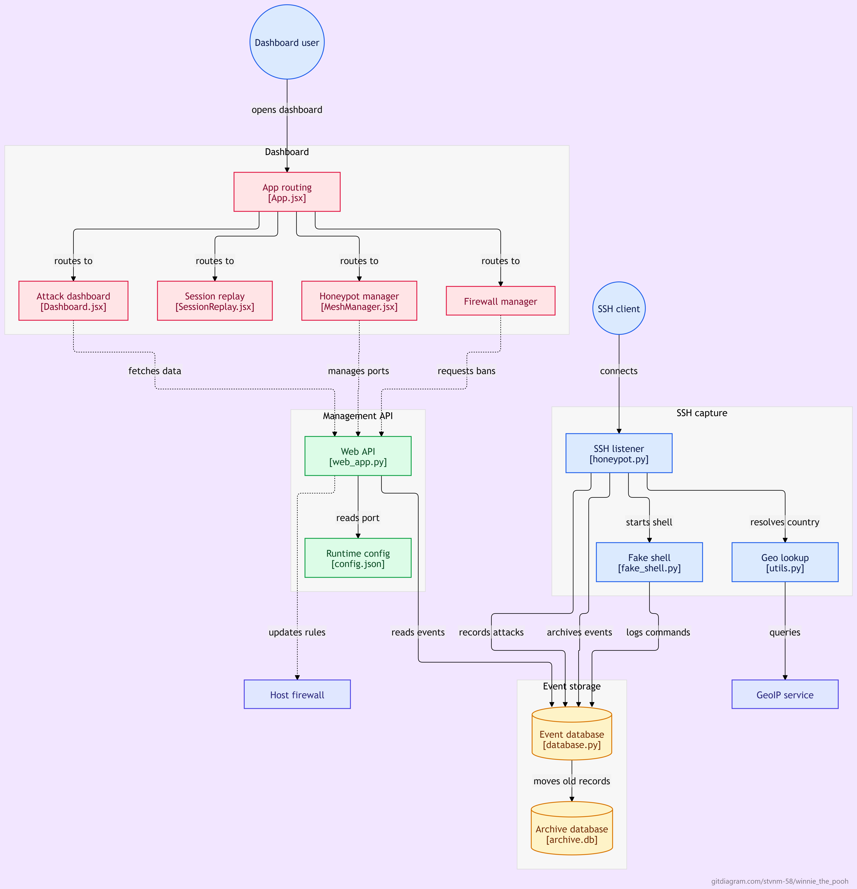

# Honeypot Swarm -- Honeypots controller

Description
-----------
This repository contains a honeypot project designed to capture unauthorized SSH connections and provide a web dashboard to visualize collected events. The project combines an SSH listener/capture component with a web interface (dashboard).

Key Features
------------
- Capture and logging of SSH connection attempts
- Local storage of events in `data/` (SQLite)
- Web dashboard to visualize attacks (templates + static assets)

Repository Structure
--------------------
- `.git/` and `.gitignore`: version control
- `venv/`: virtual environment (do not commit)
- `data/`: database and generated files (e.g. `honeypot.db`)
- `src/`: main source code
  - `honeypot.py`: listener/capture logic (e.g. using Paramiko)
  - `database.py`: persistence helpers (SQLite)
  - `web_app.py`: web application (Flask / FastAPI)
- `static/`: dashboard static files (CSS, JS)
- `templates/`: dashboard HTML templates
- `requirements/` or `requirements.txt`: Python dependencies

Requirements
------------
- Python 3.8+ installed
- `pip` to install dependencies
- (Recommended) Create a virtual environment to isolate dependencies

Quick Setup
-----------
1. Create and activate a virtual environment:

   - Unix / macOS:

     ```bash
     python3 -m venv venv
     source venv/bin/activate
     ```

   - Windows (PowerShell):

     ```powershell
     python -m venv venv
     .\venv\Scripts\Activate.ps1
     ```

2. Install dependencies from the project root:

   ```bash
   python -m pip install -r server/requirements/requirements.txt
   ```

Configuration
-------------
- Expected database file: `server/data/honeypot.db`
- On first launch, open the dashboard and create the administrator account on
  the login screen. The account is created once and the dashboard logs you in
  immediately. On later launches, enter the same ID and password. The password hash and signing key
  are stored in `server/data/auth.json`; the password is never stored in clear
  text. Subsequent launches go directly to the regular ID/password login.
- Keep `server/data/auth.json` private and include it in backups: losing it
  requires creating a new administrator account. It is excluded from Git.

- `HONEYPOT_API_HOST` controls the Flask bind address and defaults to
  `127.0.0.1`. Only bind to a public interface behind a secured deployment.
- Set `HONEYPOT_COOKIE_SECURE=true` when TLS is terminated by a reverse proxy
  and Flask does not see the original HTTPS connection.
- `HONEYPOT_ALLOWED_ORIGINS` optionally overrides the comma-separated local
  dashboard origin allowlist. Add only trusted dashboard origins.
- `VITE_API_BASE_URL` optionally overrides the frontend API base URL; its local
  default is `http://localhost:5000/api`.
  

Usage
-----
- Start the SSH listener (example):

  ```bash
  cd server
  python src/honeypot.py
  ```

- Start the web dashboard (Flask example):

  ```bash
  cd server
  python -m flask --app src.web_app run --host=127.0.0.1 --port=5000 --no-debugger --no-reload
  ```

Firewall Controls
----------------
The dashboard's ban/unban actions update the host firewall: Windows uses Windows
Defender Firewall and Linux uses `iptables`/`ip6tables`. Run the API with
administrator/root privileges. On Linux, if the API runs as an unprivileged user,
configure non-interactive `sudo` access for the required firewall commands; the
API deliberately does not prompt for a password.

For local Linux/WSL development, start the API as root instead of granting broad
passwordless sudo access to firewall commands. From the `server` directory, with
the project's virtual environment activated, run:

```bash
sudo -E "$(command -v python)" -m flask --app src.web_app run \
  --host=127.0.0.1 --port=5000 --no-debugger --no-reload
```

This binds the API to localhost and disables Flask's debugger and reloader. Keep
the privileged API local; do not expose it to an untrusted network. Loopback
addresses such as `127.0.0.1` and `::1` are intentionally rejected as ban targets
to avoid blocking local dashboard traffic.

Best Practices
--------------
- Do not commit `venv/` or `data/` (these should be in `.gitignore`)
- Secure access to the dashboard and the database if you expose the application publicly
- Captured SSH passwords are stored in clear text for honeypot analysis. Restrict
  access to the data directory and its backups, and define a retention period.



Contact
-------
For questions or contributions: open an issue or contact the repository owner.
