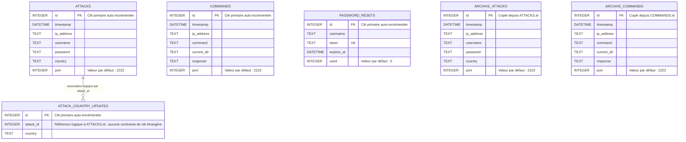

# Honeypot Swarm

Honeypot Swarm est une application auto-hébergée de leurre et de surveillance
SSH. Elle exécute des honeypots SSH basés sur Paramiko, enregistre les tentatives
d’authentification ainsi que les commandes saisies dans un shell simulé, et
propose un tableau de bord React pour examiner l’activité et gérer les instances
de honeypot.

> **Notice de sécurité :** ce logiciel est destiné à la surveillance et à la
> recherche en sécurité dans un environnement contrôlé. Un honeypot est un
> service volontairement exposé. Déployez-le uniquement sur des systèmes et des
> réseaux que vous possédez ou que vous êtes autorisé à surveiller, isolez-le
> des systèmes sensibles et limitez l’accès au tableau de bord et aux données
> stockées.

## Fonctionnalités

- Capture les tentatives de connexion SSH, notamment l’adresse IP source, le
  nom d’utilisateur, le mot de passe, l’horodatage, le port d’écoute et, si
  disponible, le pays.
- Accepte l’authentification SSH par mot de passe et fournit un shell
  **simulé** interactif. Les commandes et les réponses du shell sont
  enregistrées ; elles ne sont pas exécutées par le système d’exploitation hôte.
- Permet de consulter les statistiques d’attaque, les identifiants capturés et
  l’activité des commandes dans un tableau de bord actualisé tant qu’il est
  ouvert.
- Présente la séquence des commandes enregistrées d’une session dans la vue de
  rejeu.
- Exécute plusieurs écouteurs honeypot sur des ports distincts, déploie un
  groupe d’écouteurs dans une plage de ports ou autour d’un port de référence,
  et arrête les écouteurs depuis le gestionnaire de maillage.
- Gère les blocages par pare-feu et configure le blocage automatique à partir
  de tentatives répétées signalées.
- Stocke les enregistrements récents dans SQLite et transfère vers une base
  d’archives les enregistrements datant de plus de 30 jours.

## Architecture

```mermaid
flowchart TD

subgraph group_capture["Capture SSH"]
  node_listener["Écouteur SSH<br/>[honeypot.py]"]
  node_shell["Faux shell<br/>[fake_shell.py]"]
  node_geo["Recherche géographique<br/>[utils.py]"]
end

subgraph group_storage["Stockage des événements"]
  node_event_db[("Base des événements<br/>[database.py]")]
  node_archive_db[("Base d’archives<br/>[archive.db]")]
  node_archiver["Tâche de rétention<br/>[honeypot.py]"]
end

subgraph group_backend["API de gestion"]
  node_api["API Web<br/>[web_app.py]"]
  node_config["Configuration d’exécution<br/>[config.json]"]
end

subgraph group_interface["Tableau de bord"]
  node_app["Routage de l’application<br/>[App.jsx]"]
  node_dashboard["Tableau de bord des attaques<br/>[Dashboard.jsx]"]
  node_replay["Rejeu de session<br/>[SessionReplay.jsx]"]
  node_mesh["Gestionnaire de honeypots<br/>[MeshManager.jsx]"]
  node_firewall["Gestionnaire du pare-feu"]
end

node_attacker(("Client SSH"))
node_geo_service["Service GeoIP"]
node_host_firewall["Pare-feu de l’hôte"]
node_browser(("Utilisateur du tableau de bord"))

node_attacker -->|"se connecte"| node_listener
node_listener -->|"enregistre les attaques"| node_event_db
node_listener -->|"démarre le shell"| node_shell
node_shell -->|"journalise les commandes"| node_event_db
node_listener -->|"détermine le pays"| node_geo
node_geo -->|"interroge"| node_geo_service
node_listener -->|"démarre la tâche de rétention"| node_archiver
node_archiver -->|"transfère les enregistrements de plus de 30 jours"| node_archive_db
node_archiver -->|"lit et supprime les anciens enregistrements"| node_event_db
node_api -->|"lit les événements"| node_event_db
node_api -->|"lit le port"| node_config
node_api -.->|"met à jour les règles"| node_host_firewall
node_browser -->|"ouvre le tableau de bord"| node_app
node_app -->|"redirige vers"| node_dashboard
node_app -->|"redirige vers"| node_replay
node_app -->|"redirige vers"| node_mesh
node_app -->|"redirige vers"| node_firewall
node_dashboard -.->|"récupère les données"| node_api
node_mesh -.->|"gère les ports"| node_api
node_firewall -.->|"demande des blocages"| node_api

click node_listener "https://github.com/stvnm-58/winnie_the_pooh/blob/main/server/src/honeypot.py"
click node_shell "https://github.com/stvnm-58/winnie_the_pooh/blob/main/server/src/fake_shell.py"
click node_geo "https://github.com/stvnm-58/winnie_the_pooh/blob/main/server/src/utils.py"
click node_event_db "https://github.com/stvnm-58/winnie_the_pooh/blob/main/server/src/database.py"
click node_archive_db "https://github.com/stvnm-58/winnie_the_pooh/blob/main/server/data/archive.db"
click node_api "https://github.com/stvnm-58/winnie_the_pooh/blob/main/server/src/web_app.py"
click node_config "https://github.com/stvnm-58/winnie_the_pooh/blob/main/server/data/config.json"
click node_app "https://github.com/stvnm-58/winnie_the_pooh/blob/main/client/src/App.jsx"
click node_dashboard "https://github.com/stvnm-58/winnie_the_pooh/blob/main/client/src/pages/Dashboard.jsx"
click node_replay "https://github.com/stvnm-58/winnie_the_pooh/blob/main/client/src/pages/SessionReplay.jsx"
click node_mesh "https://github.com/stvnm-58/winnie_the_pooh/blob/main/client/src/pages/MeshManager.jsx"
click node_firewall "https://github.com/stvnm-58/winnie_the_pooh/blob/main/client/src/pages/FirewallManager.jsx"

classDef toneNeutral fill:#f8fafc,stroke:#334155,stroke-width:1.5px,color:#0f172a
classDef toneBlue fill:#dbeafe,stroke:#2563eb,stroke-width:1.5px,color:#172554
classDef toneAmber fill:#fef3c7,stroke:#d97706,stroke-width:1.5px,color:#78350f
classDef toneMint fill:#dcfce7,stroke:#16a34a,stroke-width:1.5px,color:#14532d
classDef toneRose fill:#ffe4e6,stroke:#e11d48,stroke-width:1.5px,color:#881337
classDef toneIndigo fill:#e0e7ff,stroke:#4f46e5,stroke-width:1.5px,color:#312e81
classDef toneTeal fill:#ccfbf1,stroke:#0f766e,stroke-width:1.5px,color:#134e4a
class node_listener,node_shell,node_geo,node_attacker,node_browser toneBlue
class node_event_db,node_archive_db toneAmber
class node_api,node_config toneMint
class node_app,node_dashboard,node_replay,node_mesh,node_firewall toneRose
class node_geo_service,node_host_firewall toneIndigo
```



Les principaux composants sont :

| Composant | Emplacement | Responsabilité |
|---|---|---|
| Honeypot SSH et shell simulé | `server/src/honeypot.py`, `server/src/fake_shell.py` | Accepte les sessions SSH, capture les identifiants et enregistre l’activité du shell. |
| API Flask et services de gestion | `server/src/web_app.py` | Authentification, données du tableau de bord, gestion des processus honeypot et contrôles du pare-feu. |
| Persistance SQLite | `server/src/database.py` | Enregistrements actifs et archivés des attaques et des commandes. |
| Tableau de bord React | `client/src/` | Écrans du tableau de bord, du rejeu de session, du maillage, du pare-feu et du compte. |

## Schéma de la base de données

Le diagramme entité-association ci-dessous présente les tables des bases SQLite
active et d’archives. L’association entre une attaque et ses mises à jour de
pays est logique ; SQLite ne l’impose pas au moyen d’une clé étrangère. Les
commandes sont associées à une session selon l’adresse IP source, le port du
honeypot et la plage d’horodatages.



`honeypot.db` contient `ATTACKS`, `COMMANDS`, `ATTACK_COUNTRY_UPDATES` et
`PASSWORD_RESETS`. Les enregistrements datant de plus de 30 jours sont
transférés vers `archive.db`, qui contient `ARCHIVE_ATTACKS` et
`ARCHIVE_COMMANDS`. Les identifiants de l’administrateur, les paramètres de
récupération et SMTP, ainsi que la configuration d’exécution sont stockés dans
des fichiers JSON plutôt que dans ces bases SQLite.

## Prérequis

- Python 3 et `pip`
- Node.js et `npm`
- Privilèges administrateur/root pour les opérations de gestion du pare-feu.
  Le tableau de bord et l’API de données peuvent sinon fonctionner sans
  privilèges élevés.

Les dépendances Python sont verrouillées dans
[`server/requirements/requirements.txt`](server/requirements/requirements.txt).
Les dépendances et scripts du frontend sont définis dans
[`client/package.json`](client/package.json).

## Installation locale

Démarrez le backend et le frontend dans des terminaux distincts. Sauf indication
contraire, les commandes ci-dessous sont à exécuter depuis la racine du dépôt.

### 1. Configurer l’environnement Python

**Windows PowerShell**

```powershell
py -m venv .venv
.\.venv\Scripts\Activate.ps1
python -m pip install -r server\requirements\requirements.txt
```

**Linux / macOS**

```bash
python3 -m venv .venv
source .venv/bin/activate
python -m pip install -r server/requirements/requirements.txt
```

### 2. Installer les dépendances du frontend

```bash
cd client
npm install
```

### 3. Démarrer l’API Flask

Ouvrez un autre terminal, activez l’environnement Python si nécessaire, puis
exécutez :

**Windows PowerShell**

```powershell
cd server
python -m flask --app src.web_app run --host 127.0.0.1 --port 5000 --no-debugger --no-reload
```

**Linux / macOS**

```bash
cd server
python -m flask --app src.web_app run --host 127.0.0.1 --port 5000 --no-debugger --no-reload
```

L’API est disponible à l’adresse `http://127.0.0.1:5000/api`. Pour le
développement local, laissez-la liée à l’interface de bouclage. Les contrôles
du pare-feu peuvent nécessiter des privilèges élevés ; consultez la section
[Contrôles du pare-feu](#contrôles-du-pare-feu).

### 4. Démarrer le tableau de bord

Dans un autre terminal :

```bash
cd client
npm run dev
```

Ouvrez l’URL Vite affichée dans le terminal (généralement
`http://localhost:5173`). Par défaut, le frontend utilise l’API sur le port
`5000` du même hôte que celui qui sert le tableau de bord.

### 5. Créer le compte administrateur

Lors de la première visite, l’écran de connexion vous propose de créer le
compte administrateur. Choisissez un nom d’utilisateur, un mot de passe d’au
moins 12 caractères et, si vous le souhaitez, une adresse e-mail de
récupération. Le compte est créé une seule fois et la connexion est automatique.
Lors des visites suivantes, connectez-vous avec ces identifiants.

La configuration du compte, qui comprend un hachage du mot de passe et une clé
de signature générée, est stockée dans `server/data/auth.json`. Ce fichier est
exclu de Git ; limitez-en l’accès et incluez-le dans des sauvegardes sécurisées.
Sa suppression retire le compte administrateur configuré localement.

### 6. Démarrer un écouteur SSH

Dans un autre terminal :

**Windows PowerShell**

```powershell
cd server
python src\honeypot.py
```

**Linux / macOS**

```bash
cd server
python src/honeypot.py
```

Le port d’écoute par défaut est `2222` ; il est configuré dans
`server/data/config.json`. Vous pouvez fournir un port comme argument
positionnel, par exemple `python src/honeypot.py 2223`. L’écouteur est lié à
toutes les interfaces réseau (`0.0.0.0`) ; configurez soigneusement le pare-feu
de l’hôte et l’exposition réseau.

La page **Swarm Controller** du tableau de bord permet de démarrer et d’arrêter des
écouteurs supplémentaires. **Tableau de bord** affiche l’activité capturée,
**Replay** présente les commandes enregistrées, **Pare-feu** gère les blocages
et **Compte** gère l’adresse de récupération et les paramètres SMTP.

## Configuration

### URL de l’API du frontend

Le frontend construit son URL d’API par défaut à partir du nom d’hôte du
tableau de bord et du port `5000`. Pour utiliser une autre URL d’API, définissez
`VITE_API_BASE_URL` au démarrage ou à la compilation du frontend. Incluez le
chemin `/api`, par exemple :

```powershell
$env:VITE_API_BASE_URL = "http://127.0.0.1:5000/api"
npm run dev
```

### Origines CORS

Par défaut, l’API autorise les origines Vite locales
`http://localhost:5173` et `http://127.0.0.1:5173`. Pour utiliser une autre
origine de tableau de bord, définissez `HONEYPOT_ALLOWED_ORIGINS` avec une liste
d’origines de confiance séparées par des virgules, par exemple :

```text
HONEYPOT_ALLOWED_ORIGINS=https://dashboard.example.test
```

Utilisez l’origine exacte du tableau de bord (schéma, nom d’hôte et port), et
non une URL d’API ou un caractère générique. Les requêtes API inter-origines
utilisent des cookies.

### Authentification par variables d’environnement

Pour les déploiements où les identifiants sont gérés en dehors de
l’application, l’API peut lire ensemble les trois variables d’environnement
suivantes :

- `HONEYPOT_JWT_SECRET`
- `HONEYPOT_ADMIN_USERNAME`
- `HONEYPOT_ADMIN_PASSWORD_HASH`

La valeur du mot de passe doit être un hachage compatible avec Werkzeug, et
non un mot de passe en clair. Lorsque cette configuration basée sur
l’environnement est active, gérez les modifications des identifiants dans le
même système externe de gestion des secrets. Définissez également
`HONEYPOT_ADMIN_EMAIL` si la récupération du mot de passe est nécessaire.

### Récupération du mot de passe et SMTP

Pour activer la récupération par e-mail, configurez l’adresse de récupération
et la connexion SMTP sur la page **Account** du tableau de bord, ou fournissez
les paramètres SMTP au moyen de variables d’environnement :

- `HONEYPOT_ADMIN_EMAIL`
- `HONEYPOT_SMTP_HOST`
- `HONEYPOT_SMTP_PORT` (valeur par défaut : `587`)
- `HONEYPOT_SMTP_USERNAME`
- `HONEYPOT_SMTP_PASSWORD`
- `HONEYPOT_SMTP_FROM` (par défaut, le nom d’utilisateur SMTP)

Le port `587` utilise STARTTLS ; le port `465` utilise TLS implicite. Par
exemple, Gmail nécessite généralement `smtp.gmail.com`, le port `587` et un
mot de passe d’application. Les paramètres SMTP enregistrés depuis la page du
compte sont stockés dans `server/data/auth.json` ; le mot de passe SMTP y est
stocké en clair. Protégez ce fichier et ses sauvegardes. Si les identifiants
administrateur sont fournis par des variables d’environnement, configurez et
gérez également l’adresse de récupération dans l’environnement.

### Sécurité des cookies derrière un proxy TLS

Le cookie de session est HTTP-only et sa durée de vie est fixée à huit heures.
Lorsque TLS se termine sur un proxy inverse et que l’application Flask ne voit
pas elle-même une requête HTTPS, définissez `HONEYPOT_COOKIE_SECURE=true` pour
que le cookie soit marqué Secure. Configurez le proxy pour qu’il n’accepte que
le trafic HTTPS.

## Données et confidentialité

Les données d’exécution sont stockées dans `server/data/` :

| Fichier | Utilité |
|---|---|
| `config.json` | Port principal de l’écouteur SSH (par défaut : `2222`). |
| `honeypot.db` | Attaques, commandes et enregistrements associés récemment capturés. |
| `archive.db` | Enregistrements archivés après 30 jours. |
| `auth.json` | Identifiants de l’administrateur configurés localement, paramètres de récupération et SMTP. |
| `banned_ips.json` | Liste des adresses IP bloquées et conservées localement. |

Les bases de données, la configuration d’authentification et l’état des
blocages sont exclus de Git. Les noms d’utilisateur, mots de passe, adresses IP
et commandes de shell capturés peuvent constituer des données sensibles. Ils
sont conservés à des fins d’analyse : protégez le répertoire de données et ses
sauvegardes, et définissez une politique de conservation adaptée à votre
environnement.

Pour les adresses IP publiques, l’enrichissement des données de pays interroge
le service externe `ipapi.co`. Les adresses privées ou locales sont identifiées
localement et ne nécessitent pas cette recherche. Les résultats GeoIP peuvent
être indisponibles ou retardés si le service ou le réseau est inaccessible.

## Présentation de l’API

Les routes de l’API se trouvent sous `/api`. À l’exception des routes de
configuration initiale, de connexion, de statut d’authentification et de
récupération du mot de passe, les requêtes nécessitent le cookie de session de
l’administrateur. Les requêtes d’écriture inter-origines doivent provenir d’une
origine autorisée.

| Domaine | Routes | Utilité |
|---|---|---|
| Authentification | `GET /auth-status`, `POST /setup`, `POST /login`, `GET /session`, `POST /logout` | Configuration initiale de l’administrateur et gestion de la session. |
| Compte et récupération | `GET/PATCH /account`, `POST /auth/forgot-password`, `POST /auth/reset-password` | Adresse de récupération, paramètres SMTP et réinitialisation du mot de passe. |
| Surveillance | `GET /status`, `/attacks`, `/commands`, `/stats`, `/country-updates`, `/country-updates/latest` | État du honeypot, enregistrements capturés, statistiques et mises à jour de pays asynchrones. |
| Maillage de honeypots | `GET/POST /honeypots`, `POST /honeypots/swarm`, `POST /honeypots/swarm-reference`, `DELETE /honeypots/{port}` | Démarre, liste et arrête les écouteurs ou déploie un groupe. |
| Pare-feu | `POST /ban`, `POST /unban`, `GET /banned-ips`, `/autoban-config`, `/autoban-stats`, `/attempt-stats` | Gère les blocages d’adresses IP et les paramètres de blocage automatique. |

Les routes de liste des attaques, commandes et mises à jour de pays prennent en
charge la pagination avec `limit`, `before_id` et `after_id`. La taille maximale
d’une page est de 500 éléments. La route `POST /report-attempt` sert à signaler
une tentative pour le suivi du blocage automatique et est volontairement
accessible sans cookie de session ; n’exposez pas l’API à des clients non
fiables.

## Contrôles du pare-feu

Les blocages manuels et automatiques modifient le pare-feu de l’hôte :

- Sous Windows, l’application utilise le Pare-feu Microsoft Defender (`netsh`).
- Sous Linux, elle utilise `iptables` et/ou `ip6tables`. Lorsque l’API ne
  s’exécute pas en tant que root, les commandes nécessaires sont lancées avec
  `sudo -n` non interactif.

N’exécutez l’API avec les privilèges nécessaires que lorsque vous avez besoin
de gérer le pare-feu, et laissez-la liée à l’interface de bouclage, sauf si un
déploiement sécurisé exige une autre configuration. N’accordez pas largement
des droits `sudo` sans mot de passe comme solution de facilité. Les adresses de
bouclage comme `127.0.0.1` et `::1` sont refusées comme cibles de blocage manuel
afin d’éviter de bloquer l’accès local au tableau de bord.

## Tests et vérifications

Exécutez la suite de tests du backend depuis le répertoire `server`, avec
l’environnement Python du projet activé :

```bash
python -m unittest discover -s tests -v
```

Les tests du backend utilisent des bases SQLite temporaires. Le module de test
du maillage contient également une simulation SSH locale ciblant uniquement
l’interface de bouclage ; exécutez-la explicitement lorsque les écouteurs
honeypot sont actifs sur les ports de test :

```bash
python tests/test_swarm.py
```

Exécutez le lint et la compilation de production du frontend depuis `client` :

```bash
npm run lint
npm run build
```

## Notes de production et de déploiement

- La commande Flask CLI ci-dessus est destinée au développement local. Pour un
  déploiement, utilisez un serveur WSGI adapté à la production et un proxy
  inverse sécurisé ; n’utilisez pas le serveur de développement intégré à
  Flask ni le mode debug en production.
- Gardez le tableau de bord et l’API privés ou protégez-les par des contrôles
  d’accès réseau stricts. Liez l’API à l’interface de bouclage, sauf si un proxy
  de confiance ou un réseau privé nécessite une autre interface.
- Les écouteurs SSH sont liés à `0.0.0.0`. Restreignez leur accès réseau et
  isolez le honeypot des charges de travail de production et des données
  sensibles.
- Le frontend et l’API sont des services distincts ; configurez CORS et
  `VITE_API_BASE_URL` pour l’origine réelle et de confiance du tableau de bord.
- Sauvegardez `server/data/` de manière sécurisée, en particulier `auth.json`
  et les bases SQLite. Ne commitez jamais les données d’exécution, les
  identifiants ou les secrets SMTP.
