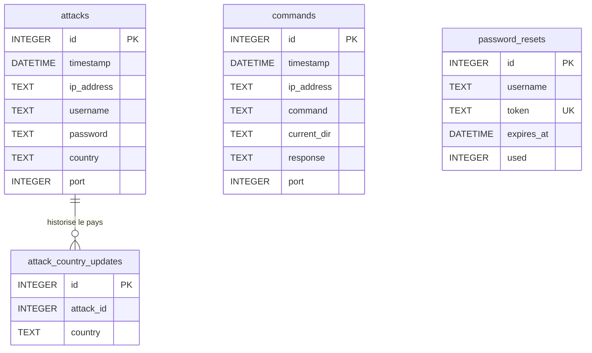

# Schéma de la base de données

Le serveur utilise deux bases SQLite dans `server/data/` :

- `honeypot.db` contient les données actives et les demandes de réinitialisation.
- `archive.db` contient les attaques et commandes archivées. Ces deux tables
  reprennent la structure des tables actives correspondantes.

## Diagramme

La relation entre `attacks` et `attack_country_updates` est logique : le code
utilise `attack_id` pour retrouver l'attaque, mais ne déclare pas de contrainte
`FOREIGN KEY` dans SQLite. De même, les attaques et commandes peuvent être
rapprochées par `ip_address` et `port`, sans relation formelle en base.

## Tables

### `attacks` — `honeypot.db` et `archive.db`

Enregistre les tentatives de connexion capturées par le honeypot.

| Colonne | Type SQLite | Détail |
|---|---|---|
| `id` | `INTEGER` | Clé primaire. Auto-incrémentée dans la base active. |
| `timestamp` | `DATETIME` | Date et heure de l'événement. |
| `ip_address` | `TEXT` | Adresse IP source. |
| `username` | `TEXT` | Nom d'utilisateur présenté. |
| `password` | `TEXT` | Mot de passe présenté. |
| `country` | `TEXT` | Pays associé à l'adresse IP, éventuellement renseigné ou mis à jour après coup. |
| `port` | `INTEGER` | Port ciblé ; valeur par défaut : `2222`. |

### `commands` — `honeypot.db` et `archive.db`

Enregistre les commandes saisies dans le faux shell et la réponse simulée.

| Colonne | Type SQLite | Détail |
|---|---|---|
| `id` | `INTEGER` | Clé primaire. Auto-incrémentée dans la base active. |
| `timestamp` | `DATETIME` | Date et heure de la commande. |
| `ip_address` | `TEXT` | Adresse IP source. |
| `command` | `TEXT` | Commande saisie. |
| `current_dir` | `TEXT` | Répertoire courant simulé. |
| `response` | `TEXT` | Réponse du faux shell. |
| `port` | `INTEGER` | Port ciblé ; valeur par défaut : `2222`. |

### `attack_country_updates` — `honeypot.db`

Journalise les mises à jour du pays d'une attaque afin que l'interface puisse
les récupérer de façon incrémentale.

| Colonne | Type SQLite | Détail |
|---|---|---|
| `id` | `INTEGER` | Clé primaire auto-incrémentée. |
| `attack_id` | `INTEGER` | Identifiant logique de l'attaque concernée. |
| `country` | `TEXT` | Nouveau pays associé. |

### `password_resets` — `honeypot.db`

Stocke les jetons de réinitialisation sous forme de hash SHA-256, ainsi que leur
expiration et leur état d'utilisation.

| Colonne | Type SQLite | Détail |
|---|---|---|
| `id` | `INTEGER` | Clé primaire auto-incrémentée. |
| `username` | `TEXT` | Identifiant du compte concerné. |
| `token` | `TEXT` | Hash du jeton, unique. |
| `expires_at` | `DATETIME` | Date d'expiration. |
| `used` | `INTEGER` | Indique si le jeton a été consommé (`0` ou `1`). |

## Stockage hors SQLite

- `server/data/auth.json` conserve la configuration du compte administrateur
  et de la récupération de compte ; le compte n'est donc pas une table SQL.
  Les paramètres d'authentification peuvent aussi venir des variables
  d'environnement.
- `server/data/config.json` contient la configuration du honeypot.
- `server/data/banned_ips.json` conserve l'état des adresses IP bannies.

## Index

La base active crée des index pour les recherches et tris fréquents :

- `attacks(timestamp, id)` et `commands(timestamp, id)`, ainsi que leurs
  variantes sur `datetime(timestamp)`.
- `attacks(ip_address, port, timestamp)` et
  `commands(ip_address, port, timestamp)` pour les sessions.
- `attacks(ip_address)` et `attacks(country)`.
- `attack_country_updates(attack_id)`.
- `password_resets(token)`.

Les anciennes attaques et commandes sont déplacées par lots de la base active
vers `archive.db` après la durée configurée (30 jours par défaut).

## Source du schéma

Ce document reflète les déclarations et migrations de
`server/src/database.py`. Les tables d'archives ne contiennent pas
`attack_country_updates` ni `password_resets`.
